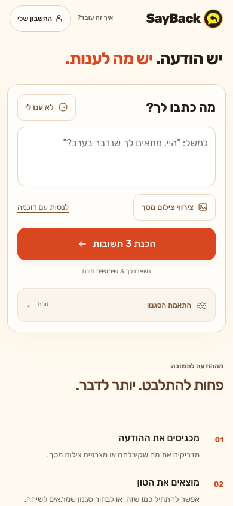
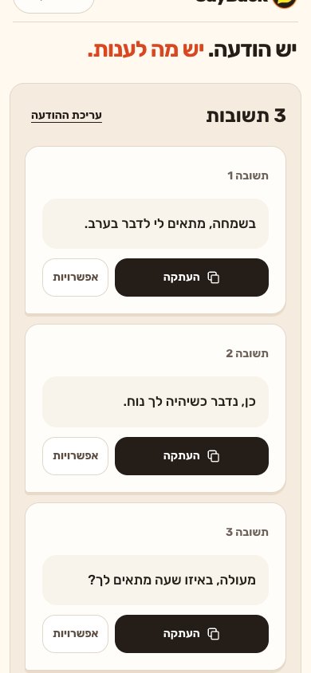
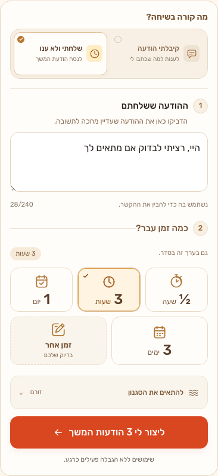
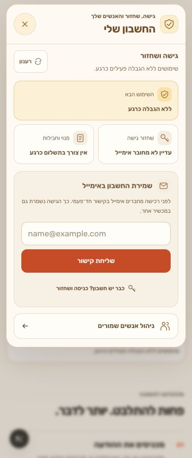

# SayBack

### The message arrived. Find the words to reply.

**Reply to a message. Follow up when nobody answers. Find three natural ways to say it in Hebrew.**

SayBack is a live, Hebrew-first web app for personal conversations, customer messages, and everyday negotiations. Choose the wording that fits, refine it if needed, and send it yourself.

**[Open the live website](https://sayback.vercel.app)** · [Visual walkthrough](docs/walkthrough.md) · [Watch the UI walkthrough](https://sayback.vercel.app/demo.html) · [Developer guide](docs/development.md)


## From message to reply

| Step | What you do |
| --- | --- |
| **1 · Choose the situation** | Reply to an incoming message with text or a screenshot, or follow up on a message you sent that is still unanswered. |
| **2 · Set the direction** | Optionally choose a tone, recipient context, goal, or Hebrew grammatical preferences. |
| **3 · Choose your words** | Compare three replies, copy one, or make it softer, sharper, or different. Nothing is sent automatically. |

<table>
  <tr><th width="50%">Write and choose a direction</th><th width="50%">Compare three replies</th></tr>
  <tr>
    <td valign="top"></td>
    <td valign="top"></td>
  </tr>
</table>

*Screenshots show the local app with non-sensitive sample data. The reply-results image uses synthetic responses and illustrates the results flow, not current live AI output. The video also uses local fixtures. Neither demonstrates live billing. [Image scope and limitations](docs/walkthrough.md#capture-scope).*

## Built around real conversations

- **Reply in your own direction.** Focused dialogs offer tone, context, goals, conversation continuation, and optional background. Open **להתאים את הסגנון** for optional direction controls; its summary retains the tone and recipient context.
- **Get Hebrew phrasing right.** Choose how replies refer to you and the recipient. Your own grammatical preference is remembered in this browser; the recipient's is temporary.
- **Refine without starting over.** Soften, sharpen, regenerate, or supply a custom rewriting instruction. Editing the incoming request marks older results as outdated.
- **Follow up when there is no answer.** Switch to **שלחתי ולא ענו**, add your last outgoing message, and choose how much time has passed, including a custom duration.
- **Upload a screenshot without manual resizing.** Supported JPEG, PNG and static WebP images are checked before decoding (up to 20 MiB, 25 megapixels and 16,384 pixels per edge). Large accepted images are prepared in the browser before sending; small supported originals stay unchanged. Unsupported formats, animation and unusually large metadata require a normal screenshot or conversion first. Cancel or replace the image before generating. Readable text and clear sender context still matter.
- **Use it on a phone.** RTL layout, a growing text field, compact controls, and scrollable dialogs keep the interaction focused.
- **Keep account actions together.** The account dialog brings access status, email-link recovery, saved people, and available billing actions into one place.

<table>
  <tr><th width="50%">Follow up thoughtfully</th><th width="50%">Keep account actions in one place</th></tr>
  <tr>
    <td valign="top"></td>
    <td valign="top"></td>
  </tr>
</table>

## Two situations, one focused workflow

| Incoming message · קיבלתי הודעה | Unanswered message · שלחתי ולא ענו |
| --- | --- |
| Add what you received as text or a screenshot. | Add the last message you sent and how long you have waited. |
| Optionally adjust tone, context and wording. | Choose an illustrated time preset or a custom number of minutes, hours or days. |
| Generate three replies and choose the one that fits. | Generate three follow-ups without pretending a new answer arrived. |

Switching modes retains each message draft and does not generate automatically. Optional style controls stay collapsed, missing details receive an inline hint, and the RTL layout is designed for phone-sized screens and keyboard navigation.

### Using screenshots

In OpenAI mode, SayBack first extracts a sender-labelled conversation, then generates replies from that transcript. It is designed to ignore keyboards and unsent drafts; ambiguous or unreadable conversations can return an error instead of a reply. If you also paste incoming text, that text remains the reply target.

Keep relevant bubbles and senders visible. Crop long or cluttered captures when needed: hidden messages cannot be recovered, and model interpretation can be wrong. Review every suggestion before sending. Image processing uses two model calls and can take longer than text-only requests. Local rule-based mode does not read images.

**Access depends on configuration.** The repository supports free-use limits, credit packs, subscriptions, coupons and open-access mode. The live site's policy may differ from a local setup or screenshot.

**Verification scope:** the repository includes browser checks with synthetic services, regression tests and separate screenshot-understanding checks. These are not a guarantee of physical-phone compatibility, real-model accuracy or payment success. See the [visual checks](docs/design-verification.md) and [screenshot checks and reproduction steps](docs/screenshot-verification.md). The latter use a configured model and incur API usage.

## Engineering at a glance

| Area | Implementation |
| --- | --- |
| **Interface** | Next.js 16.2.1 App Router, React 19.2.4, strict TypeScript, Tailwind CSS v4, Hebrew RTL |
| **Generation contract** | Server-side validation of one short `intent` and exactly three `replies`; OpenAI Responses API or local rule-based generation |
| **Identity and access** | Firebase authentication and server-side ID-token verification; Firestore-backed limits and usage accounting |
| **Failure handling** | Generation access is refunded when generation fails; refinement retains the original request context |
| **Payments** | Stripe Checkout Elements, checkout reconciliation, and idempotent webhook processing |
| **Privacy boundaries** | Generation usage logs omit message content; analytics privacy filters have regression coverage. This is not a claim that all processing happens locally. |
| **Quality gates** | ESLint, TypeScript, regression tests, and production build through `npm run check` |

### Where to look in the code

- [`app/home-page-client.tsx`](app/home-page-client.tsx): composer state, generation, results, refinement, and account flows.
- [`components/reply-direction-controls.tsx`](components/reply-direction-controls.tsx): direction dialogs and grammatical preferences.
- [`components/account-center-panel.tsx`](components/account-center-panel.tsx): account overview and actions.
- [`app/api/generate/route.ts`](app/api/generate/route.ts): authenticated generation, access checks, and failure rollback.
- [`lib/ai.ts`](lib/ai.ts): screenshot transcript extraction, AI modes, and output validation.
- [`lib/prepare-screenshot.ts`](lib/prepare-screenshot.ts): browser-side image preparation, size budgeting, and cancellation.
- [`lib/billing.ts`](lib/billing.ts): entitlements and payment lifecycle.
- [`tests/`](tests) and [`scripts/`](scripts): regression suites and browser verification tools.

## Run locally

Use **Node.js 22 LTS** and **npm 10+**. Firebase client/admin configuration is required; see [`.env.example`](.env.example) and the [developer guide](docs/development.md).

```bash
npm ci
cp .env.example .env.local
# Fill in Firebase credentials and the required environment settings.
npm run dev
```

Open `http://localhost:3000`.

- `LOCAL_FREE_AI=true` uses local rules and makes no OpenAI calls. It is not equivalent to the live AI experience.
- For OpenAI generation, set `LOCAL_FREE_AI=false` and provide `OPENAI_API_KEY`.
- Stripe credentials are needed to exercise checkout and webhooks; do not use real payments as a casual test.

```bash
npm test          # Regression suites
npm run check     # Lint + typecheck + tests + production build
```

For configuration, isolated browser fixtures, billing modes, and deployment steps, see the [complete developer guide](docs/development.md).

## More detail

- [Visual walkthrough](docs/walkthrough.md): directions, follow-ups, account UI, and screenshot scope.
- [Development guide](docs/development.md): setup, tests, configuration, and operations.
- [Video scope](docs/demos/README.md): what the recorded walkthrough does and does not demonstrate.
