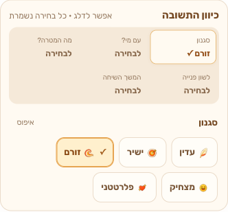
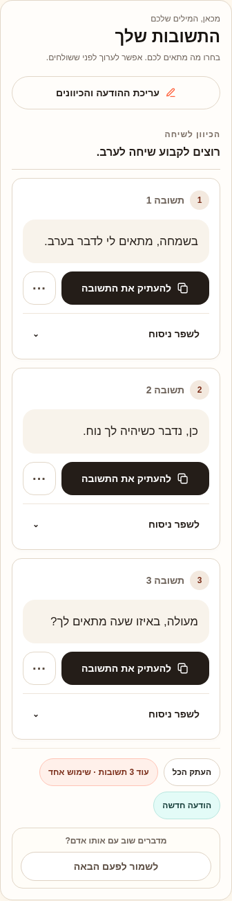

# SayBack

**Turn an incoming message into three short, natural Hebrew replies.**

SayBack is a Hebrew-first, right-to-left web app for finding the right words in personal conversations, customer messages, and everyday negotiations. Paste a message, choose a tone, then copy or refine the reply that fits.

**[Try the live app](https://sayback.vercel.app)** · [Visual walkthrough](docs/walkthrough.md) · [Setup & operations](docs/development.md)

## 40-second project demo

**[Watch the walkthrough](docs/demos/recruiter-walkthrough.mp4)** · [Demo scope and evidence](docs/demos/README.md)

Actual local UI captures with synthetic authentication, billing and generation. Fixture replies illustrate the interface; live AI and payments are not demonstrated.

## See the workflow


**One message → choose directions → compare three replies → copy or refine.**
The compact controls keep tone, recipient context, goal, language preferences,
conversation continuation, and extra background together above the generate button.
Open one inline editor, choose an option, and keep the selected value in view.

<table>
  <tr><th width="50%">1. Write and choose a direction</th><th width="50%">2. Compare and refine</th></tr>
  <tr>
    <td valign="top"></td>
    <td valign="top"></td>
  </tr>
  <tr><td>No direction is required. Start with the default <strong>זורם</strong> tone and add context only when useful.</td><td>Review the wording and choose what fits. SayBack leaves sending the message to you.</td></tr>
</table>

*Real browser captures of the updated UI, November 6, 2026, using non-sensitive
sample text and mocked authentication, billing, and generation responses. The
three replies are synthetic fixtures; these captures do not verify live AI,
Firebase, or payments. [Capture details and walkthrough](docs/walkthrough.md).*

## What it does

- **Three suggestions per request:** a short interpretation of the incoming message plus exactly three Hebrew replies.
- **Compact reply directions:** six direct controls with one inline editor; all 10 tones and 12 contexts remain available under their existing access rules. Selected values and explicit resets stay visible, including grammatical preferences. Monthly features require a monthly subscription.
- **Refinement:** soften, sharpen, regenerate, or give a custom rewriting instruction. Editing the request marks previous results as outdated; refining a result keeps its original request context.
- **Follow-ups:** draft a message when someone has not replied, using the last outgoing message and elapsed time.
- **Text or screenshot input:** image understanding is available through the configured OpenAI mode; local free mode is rule-based and does not read image contents.
- **Account and billing infrastructure:** Firebase authentication, Firestore-backed usage limits, Stripe checkout, subscriptions, and coupon redemption. Availability depends on deployment configuration and access level.

## Engineering highlights

| Area | Implementation |
| --- | --- |
| Frontend | Next.js 16.2.1 App Router, React 19.2.4, strict TypeScript, Tailwind CSS v4; Hebrew RTL interface |
| Generation | Server-side API with a schema-validated `intent` + exactly three `replies`; optional OpenAI Responses API or local rule-based mode |
| Access control | Firebase ID-token verification, Firestore-backed rate limits, usage accounting, and usage rollback when generation fails |
| Payments | Stripe Checkout Elements, checkout reconciliation, and idempotent webhook processing |
| Privacy | Message content is excluded from generation usage logs; analytics privacy filters and regression tests are included |
| Quality checks | ESLint, TypeScript, identity/conversation/personalization tests, generation and insights regressions, production build |

### Code map

- [`app/home-page-client.tsx`](app/home-page-client.tsx): generator state, input, results, refinement, and account UI.
- [`components/conversation-experience.tsx`](components/conversation-experience.tsx): shared Hebrew conversation interface.
- [`app/api/generate/route.ts`](app/api/generate/route.ts): authenticated generation request, access checks, and rollback.
- [`lib/ai.ts`](lib/ai.ts): input normalization, local/API mode selection, and output validation.
- [`lib/billing.ts`](lib/billing.ts) and [Stripe webhook](app/api/stripe/webhook/route.ts): entitlements and payment lifecycle.
- [`tests/`](tests) and [`scripts/`](scripts): regression suites and browser verification.

## Run locally

Requires Node.js 22 LTS (CI version; Next.js requires at least 20.9), npm 10+, and Firebase client/admin configuration. See [`.env.example`](.env.example) for the complete environment template.

```bash
npm ci
cp .env.example .env.local
# Fill in the required Firebase credentials and environment settings.
npm run dev
```

Open http://localhost:3000. The example environment enables `LOCAL_FREE_AI=true`, which makes no OpenAI calls. To use the OpenAI mode, set `LOCAL_FREE_AI=false` and provide `OPENAI_API_KEY`. Stripe credentials are needed for checkout and webhook functionality.

```bash
npm run check
```

This runs lint, type checking, regression suites, and a production build. For the isolated multi-viewport browser checks, analytics verification, billing bypass flags, Stripe events, coupon collections, and Vercel commands, see the **[complete development guide](docs/development.md)**.

## Documentation

- [Visual walkthrough and screenshot provenance](docs/walkthrough.md)
- [Development, configuration, verification, and deployment](docs/development.md)
- [Visitor insights](docs/visitor-insights.md)
