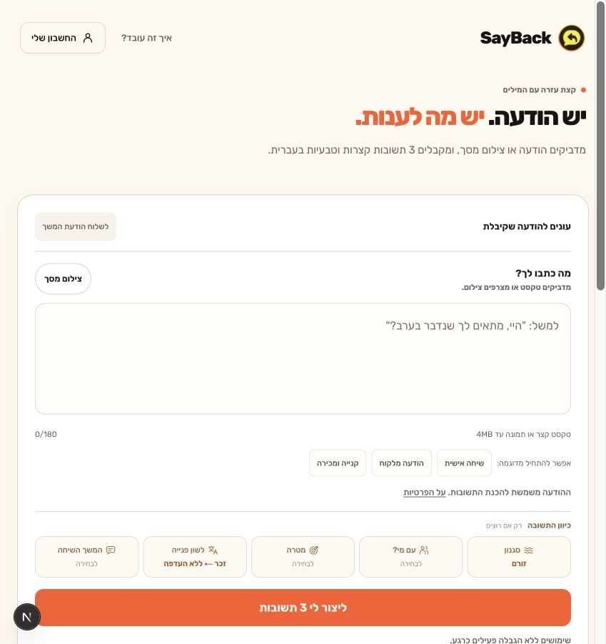
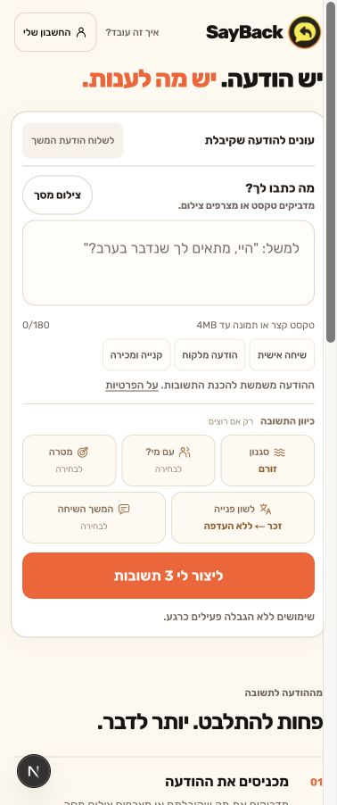
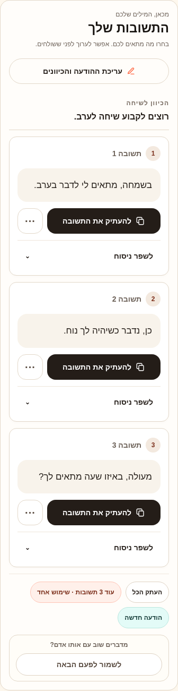
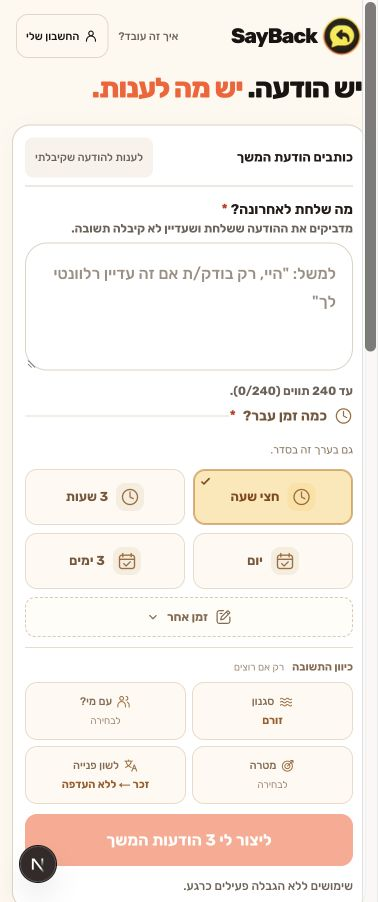

# SayBack

### The message arrived. Find the words to reply.

**Paste a message or upload a screenshot. Get three short, natural replies in Hebrew.**

SayBack is a live, Hebrew-first web app for personal conversations, customer messages, and everyday negotiations. Choose the wording that fits, refine it if needed, and send it yourself.

**[Open the live website](https://sayback.vercel.app)** · [Visual walkthrough](docs/walkthrough.md) · [Watch the UI walkthrough](https://sayback.vercel.app/demo.html) · [Developer guide](docs/development.md)



## From message to reply

| Step | What you do |
| --- | --- |
| **1 · Add the message** | Paste text or upload a screenshot. You can also start with a built-in example. |
| **2 · Set the direction** | Optionally choose a tone, recipient context, goal, or Hebrew grammatical preferences. |
| **3 · Choose your words** | Compare three replies, copy one, or make it softer, sharper, or different. Nothing is sent automatically. |

<table>
  <tr><th width="50%">Write and choose a direction</th><th width="50%">Compare three replies</th></tr>
  <tr>
    <td valign="top"></td>
    <td valign="top"></td>
  </tr>
</table>

*Screenshots show the local app with non-sensitive sample data. The reply-results image uses synthetic responses and illustrates the results flow, not current live AI output. The video also uses local fixtures. Neither demonstrates live billing. [Image scope and limitations](docs/walkthrough.md#capture-scope).*

## Built around real conversations

- **Reply in your own direction.** Focused dialogs offer tone, context, goals, conversation continuation, and optional background. Selected choices stay visible in the composer.
- **Get Hebrew phrasing right.** Choose how replies refer to you and the recipient. Your own grammatical preference is remembered in this browser; the recipient's is temporary.
- **Refine without starting over.** Soften, sharpen, regenerate, or supply a custom rewriting instruction. Editing the incoming request marks older results as outdated.
- **Follow up when there is no answer.** Switch to **לשלוח הודעת המשך**, add your last outgoing message, and choose how much time has passed, including a custom duration.
- **Use it on a phone.** RTL layout, a growing text field, compact controls, and scrollable dialogs keep the interaction focused.
- **Keep account actions together.** The account dialog brings access status, email-link recovery, saved people, and available billing actions into one place.

<table>
  <tr><th width="50%">Follow up thoughtfully</th><th width="50%">Keep account actions in one place</th></tr>
  <tr>
    <td valign="top"></td>
    <td valign="top"></td>
  </tr>
</table>

**Availability is configuration-dependent.** The repository includes free-use limits, credit packs, subscriptions, coupons, and an open-access mode. The live site's current access policy may differ from a screenshot or local setup. Screenshot understanding requires the configured OpenAI mode; the local rule-based mode does not read images.

**Screenshot support.** Heavy uploads are compressed in the browser; small supported originals remain unchanged. In OpenAI mode, high-detail vision extracts a validated, chronological conversation transcript before text-only reply generation. Keyboards and unsent drafts are excluded; ambiguous or unreadable images return a Hebrew error. Screenshot-only requests ending with your own sent message suggest an optional follow-up. Local AI mode rejects screenshots. Two model calls add latency and model usage. [Verification and limitations](docs/screenshot-verification.md).

## Engineering at a glance

| Area | Implementation |
| --- | --- |
| **Interface** | Next.js 16.2.1 App Router, React 19.2.4, strict TypeScript, Tailwind CSS v4, Hebrew RTL |
| **Generation contract** | Server-side validation of one short `intent` and exactly three `replies`; OpenAI Responses API or local rule-based generation |
| **Identity and access** | Firebase authentication and server-side ID-token verification; Firestore-backed limits and usage accounting |
| **Failure handling** | Generation access is refunded when generation fails; refinement retains the original request context |
| **Payments** | Stripe Checkout Elements, checkout reconciliation, and idempotent webhook processing |
| **Privacy boundaries** | Generation usage logs omit message content; analytics privacy filters have regression coverage. This is not a claim that all processing happens locally. |
| **Quality gates** | ESLint, TypeScript, regression tests, and production build through `npm run check` |

### Where to look in the code

- [`app/home-page-client.tsx`](app/home-page-client.tsx): composer state, generation, results, refinement, and account flows.
- [`components/reply-direction-controls.tsx`](components/reply-direction-controls.tsx): direction dialogs and grammatical preferences.
- [`components/account-center-panel.tsx`](components/account-center-panel.tsx): account overview and actions.
- [`app/api/generate/route.ts`](app/api/generate/route.ts): authenticated generation, access checks, and failure rollback.
- [`lib/ai.ts`](lib/ai.ts): input normalization, AI modes, and output validation.
- [`lib/billing.ts`](lib/billing.ts): entitlements and payment lifecycle.
- [`tests/`](tests) and [`scripts/`](scripts): regression suites and browser verification tools.

## Run locally

Use **Node.js 22 LTS** and **npm 10+**. Firebase client/admin configuration is required; see [`.env.example`](.env.example) and the [developer guide](docs/development.md).

```bash
npm ci
cp .env.example .env.local
# Fill in Firebase credentials and the required environment settings.
npm run dev
```

Open `http://localhost:3000`.

- `LOCAL_FREE_AI=true` uses local rules and makes no OpenAI calls. It is not equivalent to the live AI experience.
- For OpenAI generation, set `LOCAL_FREE_AI=false` and provide `OPENAI_API_KEY`.
- Stripe credentials are needed to exercise checkout and webhooks; do not use real payments as a casual test.

```bash
npm test          # Regression suites
npm run check     # Lint + typecheck + tests + production build
```

For configuration, isolated browser fixtures, billing modes, and deployment steps, see the [complete developer guide](docs/development.md).

## More detail

- [Visual walkthrough](docs/walkthrough.md): directions, follow-ups, account UI, and screenshot scope.
- [Development guide](docs/development.md): setup, tests, configuration, and operations.
- [Video scope](docs/demos/README.md): what the recorded walkthrough does and does not demonstrate.
