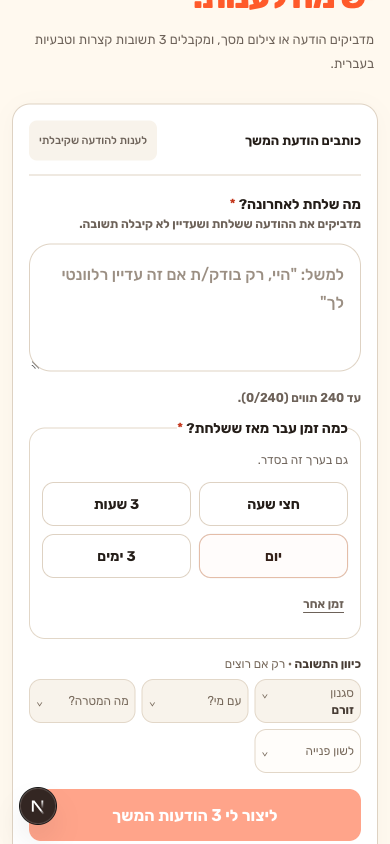
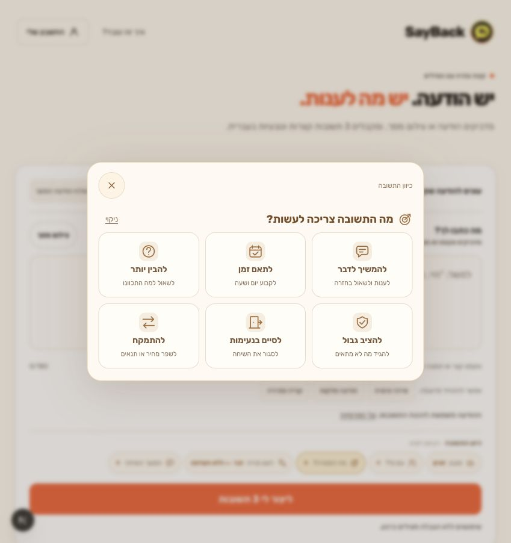
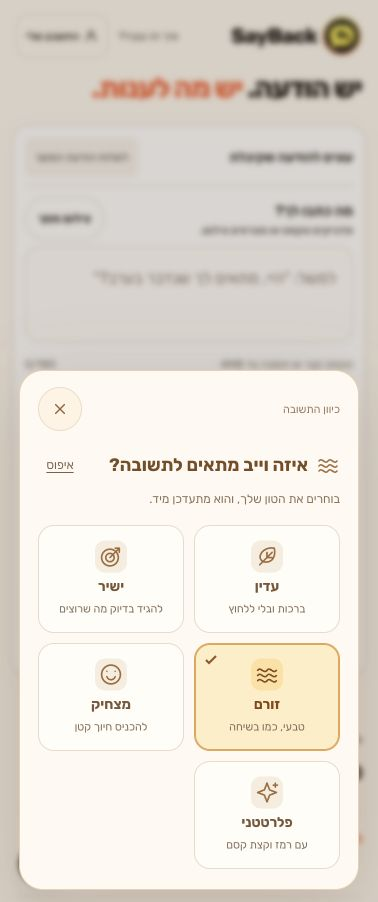
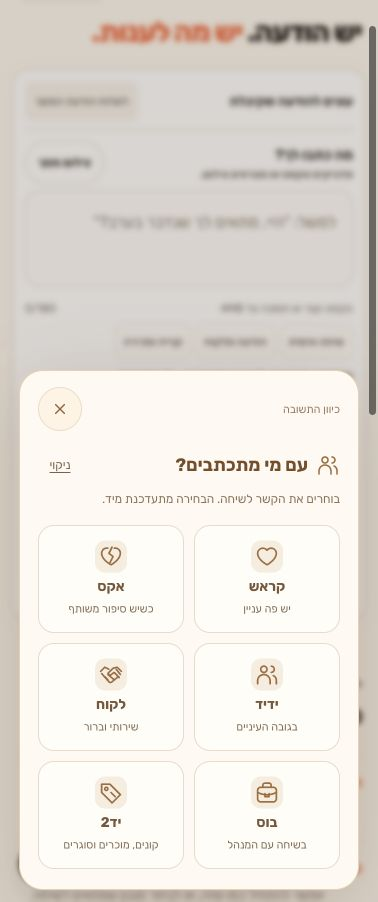
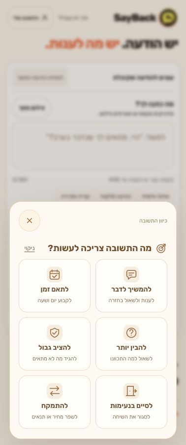
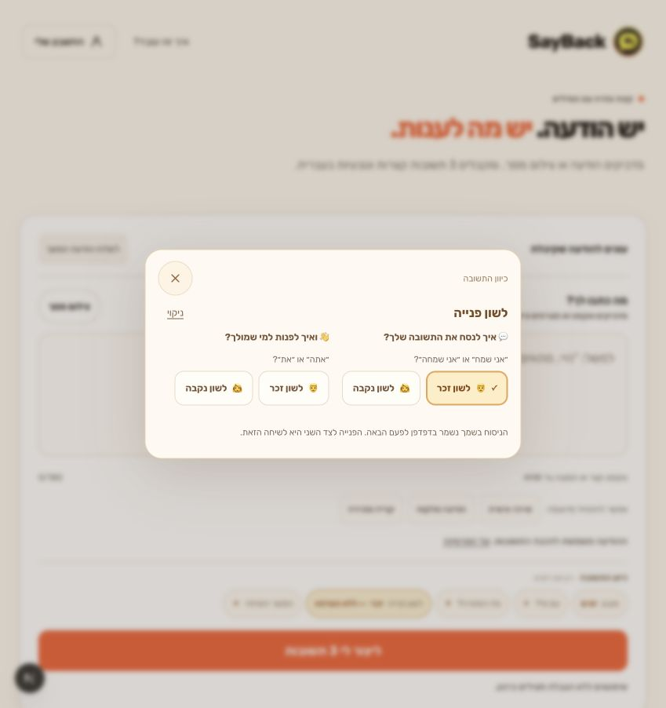
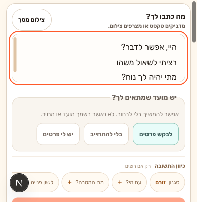

# SayBack

**Turn an incoming message into three short, natural Hebrew replies.**

SayBack is a Hebrew-first, right-to-left web app for finding the right words in personal conversations, customer messages, and everyday negotiations. Paste a message, choose a tone, then copy or refine the reply that fits.

**[Try the live app](https://sayback.vercel.app)** · [Visual walkthrough](docs/walkthrough.md) · [Setup & operations](docs/development.md)

## 40-second project demo

**[Watch the walkthrough](https://sayback.vercel.app/demo.html)** · [Demo scope and evidence](docs/demos/README.md)

Actual local UI captures with synthetic authentication, billing and generation. Fixture replies illustrate the interface; live AI and payments are not demonstrated.

## See the workflow


**One message → choose directions → compare three replies → copy or refine.**
The compact controls keep tone, recipient context, goal, language preferences,
conversation continuation, and extra background together above the generate button.
Open one inline editor, choose an option, and keep the selected value in view.

<table>
  <tr><th width="50%">1. Write and choose a direction</th><th width="50%">2. Compare and refine</th></tr>
  <tr>
    <td valign="top"></td>
    <td valign="top"></td>
  </tr>
  <tr><td>No direction is required. Start with the default <strong>זורם</strong> tone and add context only when useful.</td><td>Review the wording and choose what fits. SayBack leaves sending the message to you.</td></tr>
</table>

*Real browser captures of the updated UI, November 6, 2026, using non-sensitive
sample text and mocked authentication, billing, and generation responses. The
three replies are synthetic fixtures; these captures do not verify live AI,
Firebase, or payments. [Capture details and walkthrough](docs/walkthrough.md).*

## Send a follow-up

**לשלוח הודעת המשך** opens the follow-up composer. Paste the last outgoing message
and choose the elapsed time in one tap: half an hour, 3 hours, a day, or 3 days.
**זמן אחר** opens the exact number and minutes/hours/days controls.
No time is selected by default.



*Local browser capture, November 10, 2026. Verifies the composer layout only.*

## What it does

- **Three suggestions per request:** a short interpretation of the incoming message plus exactly three Hebrew replies.
- **Compact reply directions:** a compact composer toolbar opening focused dialogs for tone, context, goal, grammatical preferences, conversation continuation and background. Every option has a custom SVG icon, a short Hebrew label and a practical subtitle in the warm cream/orange palette. Tone, context and goals use compact cards: two columns on phones and three from 600px wide; continuation uses two side-by-side cards. All six incoming goals fit without scrolling at 320×568 and at 849×902, while keeping their short descriptions visible. Language preferences retain their two-part guided flow. Long lists scroll inside the dialog with the close control remaining visible. Selected values stay visible in the category buttons; selecting an option closes the dialog without advancing to another category, except grammatical preferences, which stay open until both questions have been chosen during that visit. Speaker grammatical preference is remembered in this browser; recipient preference stays temporary; all 10 tones and 12 contexts remain available under their existing access rules. Selected values and explicit resets stay visible, including grammatical preferences. Monthly features require a monthly subscription.
- **Refinement:** soften, sharpen, regenerate, or give a custom rewriting instruction. Editing the request marks previous results as outdated; refining a result keeps its original request context.
- **Follow-ups:** draft a message when someone has not replied, using the last outgoing message and elapsed time.
- **Text or screenshot input:** image understanding is available through the configured OpenAI mode; local free mode is rule-based and does not read image contents.
- **Account and billing infrastructure:** Firebase authentication, Firestore-backed usage limits, Stripe checkout, subscriptions, and coupon redemption. Availability depends on deployment configuration and access level.

## Engineering highlights

| Area | Implementation |
| --- | --- |
| Frontend | Next.js 16.2.1 App Router, React 19.2.4, strict TypeScript, Tailwind CSS v4; Hebrew RTL interface |
| Generation | Server-side API with a schema-validated `intent` + exactly three `replies`; optional OpenAI Responses API or local rule-based mode |
| Access control | Firebase ID-token verification, Firestore-backed rate limits, usage accounting, and usage rollback when generation fails |
| Payments | Stripe Checkout Elements, checkout reconciliation, and idempotent webhook processing |
| Privacy | Message content is excluded from generation usage logs; analytics privacy filters and regression tests are included |
| Quality checks | ESLint, TypeScript, identity/conversation/personalization tests, generation and insights regressions, production build |

### Code map

- [`app/home-page-client.tsx`](app/home-page-client.tsx): generator state, input, results, refinement, and account UI.
- [`components/conversation-experience.tsx`](components/conversation-experience.tsx): shared Hebrew conversation interface.
- [`app/api/generate/route.ts`](app/api/generate/route.ts): authenticated generation request, access checks, and rollback.
- [`lib/ai.ts`](lib/ai.ts): input normalization, local/API mode selection, and output validation.
- [`lib/billing.ts`](lib/billing.ts) and [Stripe webhook](app/api/stripe/webhook/route.ts): entitlements and payment lifecycle.
- [`tests/`](tests) and [`scripts/`](scripts): regression suites and browser verification.

## Run locally

Requires Node.js 22 LTS (CI version; Next.js requires at least 20.9), npm 10+, and Firebase client/admin configuration. See [`.env.example`](.env.example) for the complete environment template.

```bash
npm ci
cp .env.example .env.local
# Fill in the required Firebase credentials and environment settings.
npm run dev
```

Open http://localhost:3000. The example environment enables `LOCAL_FREE_AI=true`, which makes no OpenAI calls. To use the OpenAI mode, set `LOCAL_FREE_AI=false` and provide `OPENAI_API_KEY`. Stripe credentials are needed for checkout and webhook functionality.

```bash
npm run check
```

This runs lint, type checking, regression suites, and a production build. For the isolated multi-viewport browser checks, analytics verification, billing bypass flags, Stripe events, coupon collections, and Vercel commands, see the **[complete development guide](docs/development.md)**.

## Documentation

- [Visual walkthrough and screenshot provenance](docs/walkthrough.md)
- [Development, configuration, verification, and deployment](docs/development.md)
- [Visitor insights](docs/visitor-insights.md)

Mobile layout verified at 320×568, 360×740, 375×667 and 390×844 CSS pixels: the incoming message field, direction toolbar and generation action fit in the initial viewport. Direction dialogs close on selection (after both questions for grammatical preferences), Escape or a click outside. These checks use browser emulation; an on-screen phone keyboard reduces available space.

The incoming message field grows and shrinks with its content, capped at 160px on phones (120px on short viewports) and 240px on desktop, with internal scrolling beyond the cap. Direction dialogs use a circular 44px close control.



<table>
  <tr><th>Style</th><th>Recipient context</th><th>Goal</th></tr>
  <tr>
    <td></td>
    <td></td>
    <td></td>
  </tr>
</table>

Local UI captures, November 14, 2026. Checked at 320×568, 378×902 and 849×902 CSS pixels, including selection, reset, scrolling and follow-up goals. Monthly-only choices/background were checked in code and type validation; their live entitlement and payment flows were not exercised in this UI change.

The grammatical preference dialog stacks two clear questions, each with a pair of generous masculine/feminine buttons and short Hebrew examples. Custom inline SVG illustrations keep the icons consistent across devices. Each choice applies immediately: the first moves focus to the other question and highlights it; choosing both sides during the current visit closes the dialog automatically, in either order. Changing the same side again keeps it open, and closing early keeps that choice. Use **ניקוי** to clear both preferences and restart this flow; there is no separate “no preference” option or save button.



### Mobile keyboard layout

The UI observes `visualViewport` resize/scroll and focus changes, keeping dialogs within the visible area. While typing on a small viewport, the incoming composer hides introductory content and uses a compact direction strip. Follow-up mode keeps the direction strip and generation action above the keyboard, reserving scroll space and revealing the focused field. Text inputs use 16px text on mobile.

Verified with reduced viewports (390×400, 375×360, 320×320), plus an emulated visual-viewport shrink with the layout viewport unchanged: multiline incoming text, follow-up text, custom numeric time, account email, and restoration after dismissal. Actual iOS/Android keyboard behavior and hosted Stripe fields still require a physical-device pass; no payment or email was submitted.


