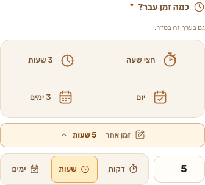

# Visual refresh — November 15, 2026

The product remains a Hebrew RTL assistant for generating exactly three short replies. The refresh preserves the existing cream/orange identity and uses warm ink, sand and gold throughout the changed interface. Green was rejected during review and removed from the refreshed surfaces and palette tokens.

## Browser evidence

Chromium checks used synthetic Firebase identity, bearer-authenticated billing responses, generation and subscription data. API requests were intercepted; no purchase was submitted and no live message was sent to an AI provider.

- Widths: 320, 360, 390, 768, 1024, 1440px; no horizontal document overflow; generation produced exactly three visible reply cards.
- Account: focus enters and stays in the dialog, Escape closes it, focus returns, and the message draft survives.
- Screenshot attachment: preview and removal.
- Refinement: softer, sharper and retry retain the original result context; generation errors preserve results and clipboard denial exposes a manual-copy fallback.
- Access states: daily free, monthly, blocked and bypass, with synthetic data.
- Example and deep-link prefill do not trigger generation.
- Follow-up: last outgoing message plus the three-hour preset reaches the generation payload.
- All six direction dialogs fit the phone width and close with Escape.

The original `verify-conversation-experience.mjs` uses obsolete inline-editor selectors. A temporary adaptation of the existing companion smoke script used the current direction dialogs and follow-up preset controls. The original scripts and pre-existing untracked files were left unchanged.

## Captures

## Limits

No physical-device keyboard test, live Firebase authentication, live AI output-quality test, Stripe charge or live webhook reconciliation was performed. Changes are local and committed; no deployment is included. Server-side generation, billing and authentication logic is unchanged.

## Required-field guidance

Verified after the follow-up validation update at 390×900 and 849×900, with reduced motion on the phone and smooth scrolling at 849px. Clicking the muted generation action focuses and reveals the first missing detail: outgoing message, a duration preset, or the custom time unit. Only the relevant inline hint appears; typing clears it. Incomplete submissions make no generation request, a valid submission makes one, and the action is disabled while generation is pending. The custom duration editor does not open automatically. Full regression suite: 175 tests passed.

## Compact illustrated duration picker

The custom time unit dropdown is replaced by native radio choices for minutes, hours and days beside the number input. Stopwatch, clock and calendar SVGs distinguish the units; the quick presets share the same illustrations inside a single cream selection rail. Selected choices retain the warm gold treatment. Chromium checks at 320, 390 and 849px verified no document overflow, 44px minimum unit targets, all three selections, missing-unit focus, collapse/reopen retention and a synthetic five-hour generation payload. Lint, TypeScript, generator-flow tests and production build passed.

