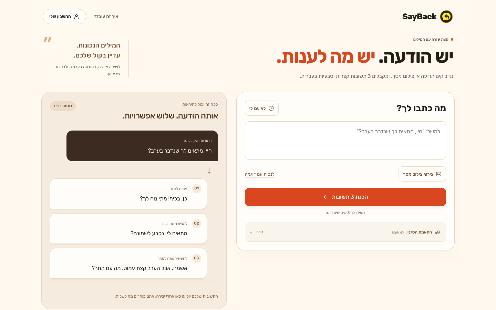
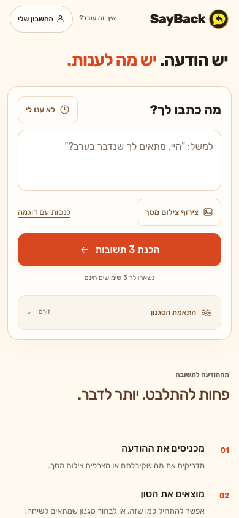
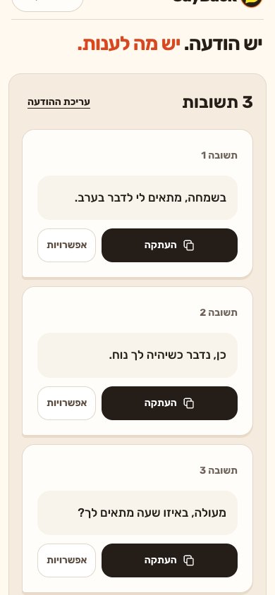
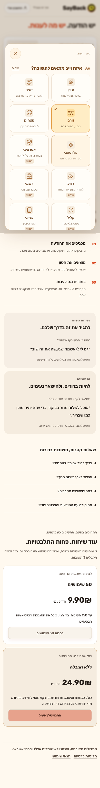
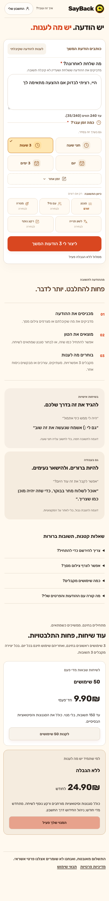
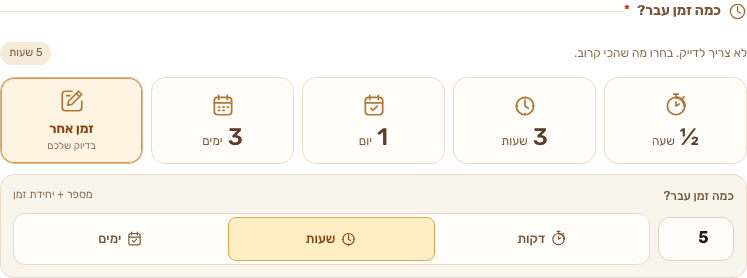
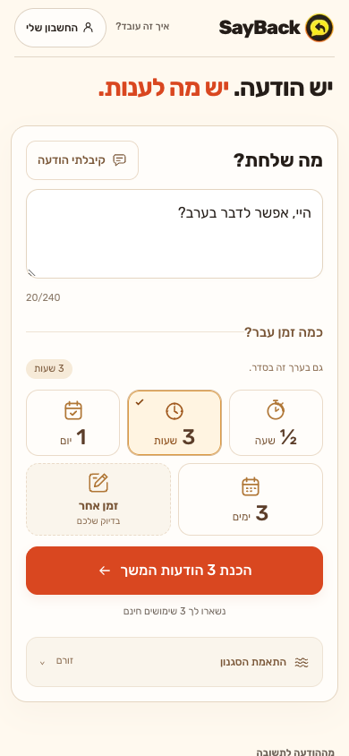
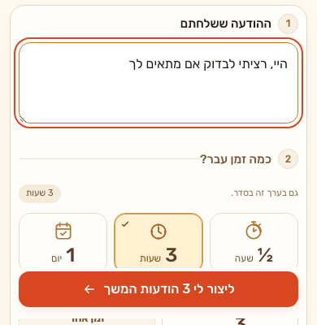

# Visual refresh — November 15, 2026

The product remains a Hebrew RTL assistant for generating exactly three short replies. The refresh preserves the existing cream/orange identity and uses warm ink, sand and gold throughout the changed interface. Green was rejected during review and removed from the refreshed surfaces and palette tokens.

## Browser evidence

Chromium checks used synthetic Firebase identity, bearer-authenticated billing responses, generation and subscription data. API requests were intercepted; no purchase was submitted and no live message was sent to an AI provider.

- Widths: 320, 360, 390, 768, 1024, 1440px; no horizontal document overflow; generation produced exactly three visible reply cards.
- Account: focus enters and stays in the dialog, Escape closes it, focus returns, and the message draft survives.
- Screenshot attachment: preview and removal.
- Refinement: softer, sharper and retry retain the original result context; generation errors preserve results and clipboard denial exposes a manual-copy fallback.
- Access states: daily free, monthly, blocked and bypass, with synthetic data.
- Example and deep-link prefill do not trigger generation.
- Follow-up: last outgoing message plus the three-hour preset reaches the generation payload.
- All six direction dialogs fit the phone width and close with Escape.

The original `verify-conversation-experience.mjs` uses obsolete inline-editor selectors. A temporary adaptation of the existing companion smoke script used the current direction dialogs and follow-up preset controls. The original scripts and pre-existing untracked files were left unchanged.

## Captures

## Limits

No physical-device keyboard test, live Firebase authentication, live AI output-quality test, Stripe charge or live webhook reconciliation was performed. Changes are local and committed; no deployment is included. Server-side generation, billing and authentication logic is unchanged.

## Required-field guidance

Verified after the follow-up validation update at 390×900 and 849×900, with reduced motion on the phone and smooth scrolling at 849px. Clicking the muted generation action focuses and reveals the first missing detail: outgoing message, a duration preset, or the custom time unit. Only the relevant inline hint appears; typing clears it. Incomplete submissions make no generation request, a valid submission makes one, and the action is disabled while generation is pending. The custom duration editor does not open automatically. Full regression suite: 175 tests passed.

## Rebuilt duration picker

The elapsed-time section is rebuilt as one five-choice picker: four illustrated presets and a custom-time card. Preset amounts are prominent, the custom option shares the grid, and a selected-duration badge remains visible above it. The custom card opens a contained, labelled number-and-unit editor. Mobile uses a balanced 3+2 grid; desktop uses five columns. The cream, orange, warm ink and gold palette is preserved.

Chromium checks at 320, 390 and 849px verified no document overflow, 44px minimum unit targets, all unit selections, missing-unit focus, collapse/reopen retention and a synthetic five-hour generation payload. Lint, TypeScript, generator-flow tests and production build passed. Screenshots use synthetic identity and generation; live AI and payments are not verified.

## Shared phone-first composers

Incoming replies and follow-ups now share a compact title/icon, numbered message input, discreet support actions, collapsible optional style preferences and a clear generation action. Follow-ups have a second numbered elapsed-time step. Input height and supporting copy are reduced for phones; the follow-up action stays visible during editing.

Verified with synthetic identity/billing/generation at 320, 390, 849 and 1440px: no horizontal overflow, optional preferences and tone dialog, screenshot upload/removal, incoming generation with exactly three replies. Follow-up checks at 320, 390 and 849px retain custom time, optional preferences and the five-hour payload. Reduced-height 320/390×400 simulations keep the focused follow-up text and action visible without overlap, restore the normal layout and allow switching to the incoming form. These are browser simulations, not physical iPhone/Android keyboard tests.

Lint, TypeScript, 175 regression tests and production build passed. Live AI and payments were not exercised.

## Two visible writing modes

A two-choice picker replaces the one-way mode links. Both options remain visible: incoming message and sent-but-unanswered message, with icons, descriptions and an exclusive `aria-pressed` state. Chromium checks at 320, 390, 849 and 1440px verified exactly two choices, 44px minimum targets, click/Space activation, retained message drafts, no automatic generation and the follow-up payload. The mode picker hides during compact phone editing and returns afterward. The regression suite remains at 175 passing tests.

## Keyboard-only focus rings

The composer records pointer versus navigation-key input without moving or blurring focus. Pointer input suppresses focus outlines and Tailwind rings, including when clicking the same control after keyboard navigation; navigation keys restore the normal `:focus-visible` styles. Duration radio labels follow the same rule. Selection styles remain intact. Chromium checks at 390 and 849px cover mouse, Tab/Shift+Tab, mouse-after-keyboard, a touch pointer event, retained focus/selection, and text spaces not re-enabling navigation rings. Touch was simulated; no physical phone test was performed.

## Automatic screenshot compression

Removed the visible file-size copy and source-size rejection. A generated 14,725,370-byte PNG was compressed by the real browser encoder to a 3,533,627-character JPEG data URL (budget: 4,194,304), preserving 2200×2200 dimensions. The text header was inspected visually. Small PNG bytes were preserved; pre-start and in-flight aborts and corrupt/non-image failures were checked. `scripts/verify-image-compression.mjs` reproduces these codec checks offline.

The actual 390px upload UI was also checked with a valid image larger than 4 MiB: busy submit guard, compressed generation payload, cancellation, replacement race, mode-change abort and no stale preview. Generation/billing were synthetic; no live AI was called. Lint, TypeScript, 176 regression tests and production build are the release gates. Physical-device memory limits and browser-unsupported image formats are not guaranteed by these desktop Chromium checks.

## Shorter writing and results flow · November 23, 2026

Google Chrome captured the same incoming message and synthetic replies on the baseline commit `d29f0c4` and the updated branch. Each comparison puts the baseline on the left and the update on the right.

| Screen | Phone, 390 × 844 | Desktop, 1440 × 900 |
| --- | --- | --- |
| Composer | [Before and after](screenshots/compare-compose-mobile.png) | [Before and after](screenshots/compare-compose-desktop.png) |
| Three replies | [Before and after](screenshots/compare-results-mobile.png) | |
| Copy and options | [Before and after](screenshots/compare-options-mobile.png) | |
| Follow-up | [Before and after](screenshots/compare-followup-mobile.png) | |
| Attached screenshot | [Before and after](screenshots/compare-image-mobile.png) | |

On the phone, the bottom edge of the first copy button moved from 552px to 372px below the top of the viewport after automatic results navigation. Both versions kept it on screen. The updated flow exposed all three copy actions in this fixture. One generation click and one copy click copied the selected text without opening preferences or a menu.

Chrome exercised text paste, local image upload, and follow-up generation with a three-hour interval. All three preset refinements and a custom instruction replaced the chosen reply. Restoring its prior wording, saving a manual edit and falling back to manual copy after clipboard denial also passed. The updated interface received keyboard input for the examples disclosure and Tab navigation while the incoming field was focused at a simulated keyboard height of 450px. The captures used a local development server, intercepted anonymous Firebase sign-in, bearer-authenticated billing responses, synthetic generation, a clipboard fixture and reduced motion. Physical-device keyboards on iOS/Android, live AI and payment processing require separate verification.
