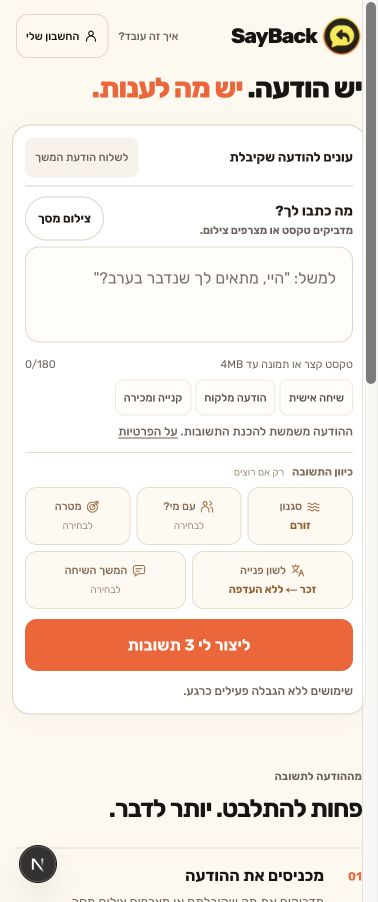
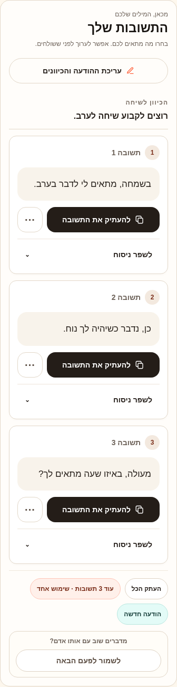
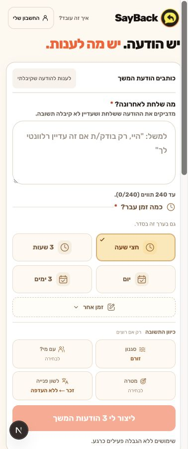
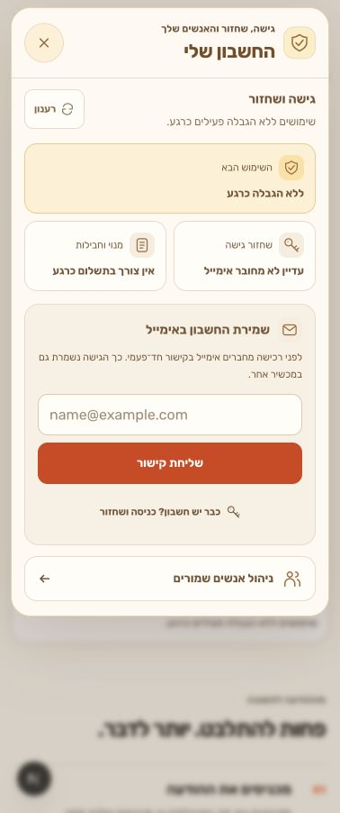

# SayBack visual walkthrough

[Project overview](../README.md) · [Open the live website](https://sayback.vercel.app)

SayBack turns an incoming message into three short Hebrew reply suggestions. These screenshots illustrate the interface; see [capture scope](#capture-scope) before treating them as evidence of live services.

## 1. Add the message

Paste text, choose a built-in example, or upload a screenshot. The text field grows with its contents. The incoming composer keeps the reply-direction controls and generation action together.

## 2. Choose only the guidance you need

Open a direction button to choose tone, recipient context, goal, grammatical preferences, or conversation continuation. Background and some options depend on access level. A selection stays visible on its button; reset controls clear it.

<table>
  <tr><th>Tone</th><th>Recipient</th><th>Goal</th></tr>
  <tr>
    <td></td>
    <td></td>
    <td></td>
  </tr>
</table>

Single-choice options close their dialog after selection. Grammatical preferences ask two questions: how to refer to you and how to refer to the recipient. Choosing both during the current visit closes the dialog; closing early keeps the choice already made. Your own preference is remembered in this browser. Use **ניקוי** to clear the preferences.

## 3. Compare and refine

Generation produces one short interpretation and exactly three reply cards. Review the text, copy what fits, or soften, sharpen, regenerate, or give a custom rewriting instruction. SayBack does not send the message for you. Changing the request marks existing replies as outdated; refinement retains the original request context.

## 4. Follow up when there is no reply

Choose **לשלוח הודעת המשך**, paste the last message you sent, and select the elapsed time. Presets include half an hour, three hours, a day, and three days. **זמן אחר** lets you enter a number and a time unit. No time is selected by default.

## 5. Manage access and account recovery

The account dialog displays current access and available actions, including email-link recovery and saved people. Plan, coupon, and subscription controls depend on configuration and account state. The screenshot below shows open access, not a permanent pricing promise.

## Capture scope

- These are existing local-browser captures checked against the current component structure. This documentation update reuses them; it does not claim to have recaptured the live website.
- Composer, direction, follow-up, and account images show the redesigned dialog-based interface. The reply-results image is an earlier local fixture, retained to explain the three-reply flow rather than to establish pixel-perfect parity with today's live results.
- Reply-results and recorded-video responses are synthetic. Account and access examples may use stubbed services. They do not demonstrate live OpenAI quality, email delivery, subscriptions, or payment reconciliation.
- Inputs are examples, not private customer conversations. No capture date is overlaid or used as a promotional label.
- Browser viewport emulation is not a physical iOS/Android keyboard test. Hosted payment fields and real device behavior require separate validation.
- The older `01-compose.jpg`, `02-style.jpg`, `03-replies.jpg`, and inline-editor screenshots remain in repository history/assets but are not presented here as the current interface.

For implementation checks and service setup, see the [developer guide](development.md).
