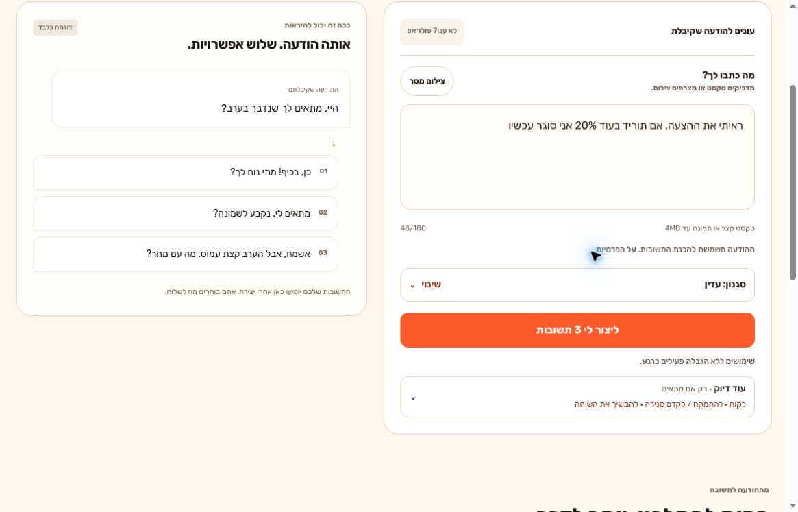
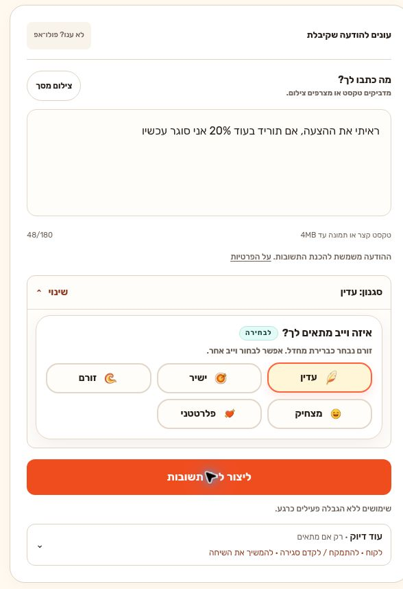
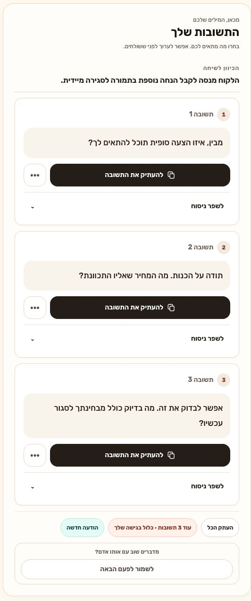

# SayBack visual walkthrough

[Back to project overview](../README.md) · [Open the live app](https://sayback.vercel.app)

These are actual browser captures from the public live site on **November 6, 2026**. The walkthrough uses the site's built-in **הודעה מלקוח** (customer message) example, not a real person's conversation.

## 1. Start with an incoming message

Paste the text, attach a screenshot, or choose a built-in example. The preview on the left of this first capture is explicitly labeled as an example, not the result of the entered customer message.

## 2. Choose the tone

The customer example selects a gentle tone and negotiation context. The expanded tone controls show the available alternatives; the additional context is optional.

## 3. Compare the result

One completed generation produced a short interpretation and exactly three replies. Each reply has copy and refinement controls. The user decides what to send.

## Capture notes

- **Source:** https://sayback.vercel.app
- **Capture date:** 2026-11-06 UTC.
- **Input:** built-in customer sample: “ראיתי את ההצעה, אם תוריד בעוד 20% אני סוגר עכשיו”.
- **Selected context:** customer; gentle tone; negotiation/closing; continue the conversation.
- **Capture method:** browser screenshots, with focused captures of the composer and result panels. No fabricated UI or replacement text.
- **Privacy:** no personal messages, names, email addresses, payment details, or private account screens were captured.
- **Verified live:** public page loads, built-in example selection, tone controls, and one completed three-reply generation.
- **Not covered by this walkthrough:** image understanding, account linking, saved conversations, paid checkout, webhook delivery, or the entire regression suite.
- Deployment settings may change. The screenshots show the site as captured, not a guarantee of ongoing unlimited access or of a particular backend model.

The documentation update changes only the README, documentation pages, and screenshot files. It does not change application code or deployment settings.
