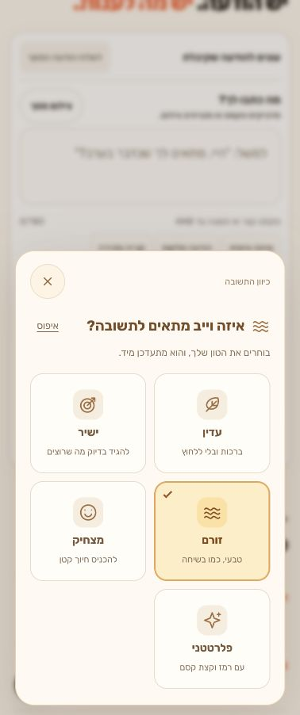
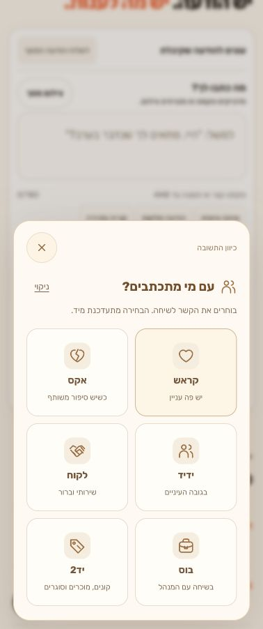
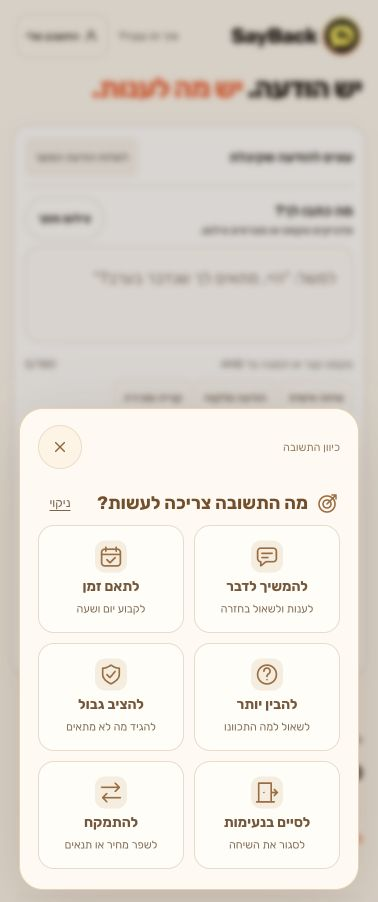
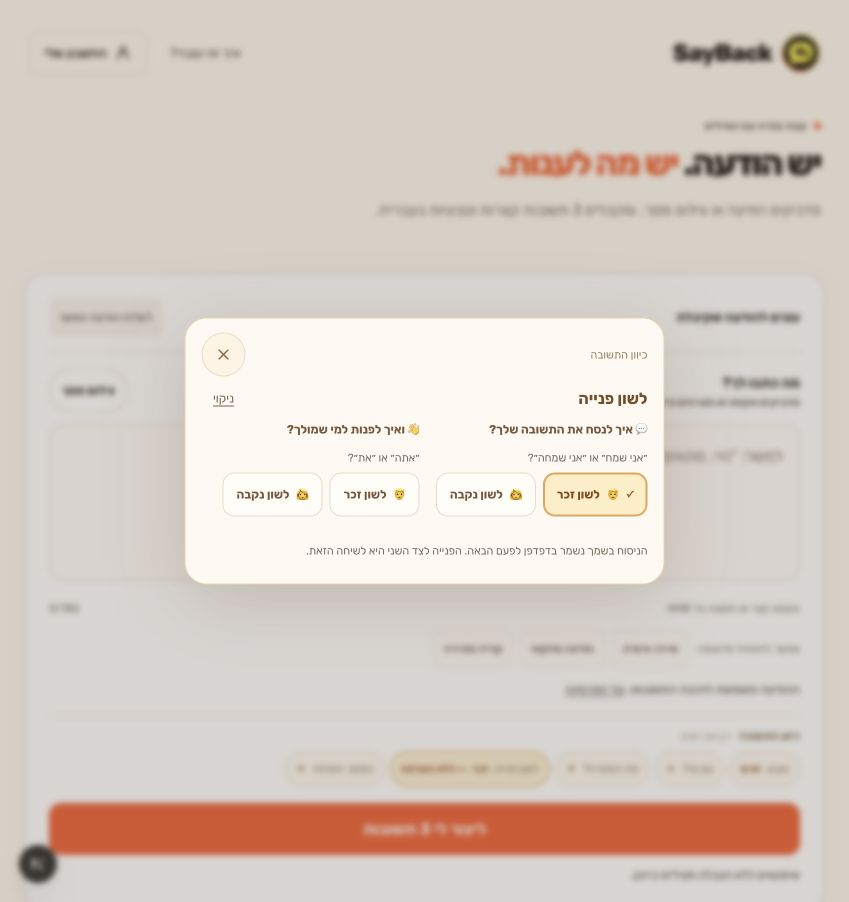

# SayBack visual walkthrough

[Project overview](../README.md) · [Open the live website](https://sayback.vercel.app)

SayBack turns an incoming message into three short Hebrew reply suggestions. These screenshots illustrate the interface; see [capture scope](#capture-scope) before treating them as evidence of live services.

## 1. Add the message

The composer opens at **מה כתבו לך?**. Paste a message, attach a screenshot, or open **לנסות עם דוגמה** to try a sample. Select **הכנת 3 תשובות** to generate. For an unanswered outgoing message, choose **לא ענו לי** beside the heading.

## 2. Choose only the guidance you need

Open **התאמת הסגנון** below the generation button, then a direction button to choose tone, recipient context, goal, grammatical preferences, or conversation continuation. Background and some options depend on access level. A selection stays visible on its button; reset controls clear it.

<table>
  <tr><th>Tone</th><th>Recipient</th><th>Goal</th></tr>
  <tr>
    <td></td>
    <td></td>
    <td></td>
  </tr>
</table>

Single-choice options close their dialog after selection. Grammatical preferences ask two questions: how to refer to you and how to refer to the recipient. Choosing both during the current visit closes the dialog; closing early keeps the choice already made. Your own preference is remembered in this browser. Use **ניקוי** to clear the preferences.

## 3. Compare and refine

Generation opens three reply cards. Choose **העתקה** on a card to copy its text. Open **אפשרויות** for manual editing, sharing, continuation and AI refinement. The AI controls show the cost and accept a custom instruction. To read the short interpretation, open **למה הניסוחים האלה?** below the replies. SayBack does not send the message for you. Changing the request marks existing replies as outdated; refinement retains the original request context.

## 4. Follow up when there is no reply

Choose **לא ענו לי**, paste the last message you sent, and select the elapsed time. One five-card picker offers half an hour, three hours, a day, three days, and **זמן אחר**. The custom option opens a compact number input and illustrated minutes/hours/days choices. Clicking an incomplete request guides you to its first missing detail. No time is selected by default.

## 5. Manage access and account recovery

The account dialog displays current access and available actions, including email-link recovery and saved people. Plan, coupon, and subscription controls depend on configuration and account state. The screenshot below shows open access, not a permanent pricing promise.

## Capture scope

- Composer, follow-up and reply-results captures were refreshed locally on November 23, 2026 using synthetic authentication, billing and generation. They do not demonstrate the deployed website or live services. Direction-dialog and account screenshots are retained from the earlier local walkthrough.
- The composers use the shared phone-first layout and collapsible optional preferences. Detailed viewport checks and keyboard-simulation limits are recorded in [visual verification](design-verification.md).
- Reply-results and recorded-video responses are synthetic. Account and access examples may use stubbed services. They do not demonstrate live OpenAI quality, email delivery, subscriptions, or payment reconciliation.
- Inputs are examples, not private customer conversations. No capture date is overlaid or used as a promotional label.
- Browser viewport emulation is not a physical iOS/Android keyboard test. Hosted payment fields and real device behavior require separate validation.
- The older `01-compose.jpg`, `02-style.jpg`, `03-replies.jpg`, and inline-editor screenshots remain in repository history/assets but are not presented here as the current interface.

For implementation checks and service setup, see the [developer guide](development.md).
